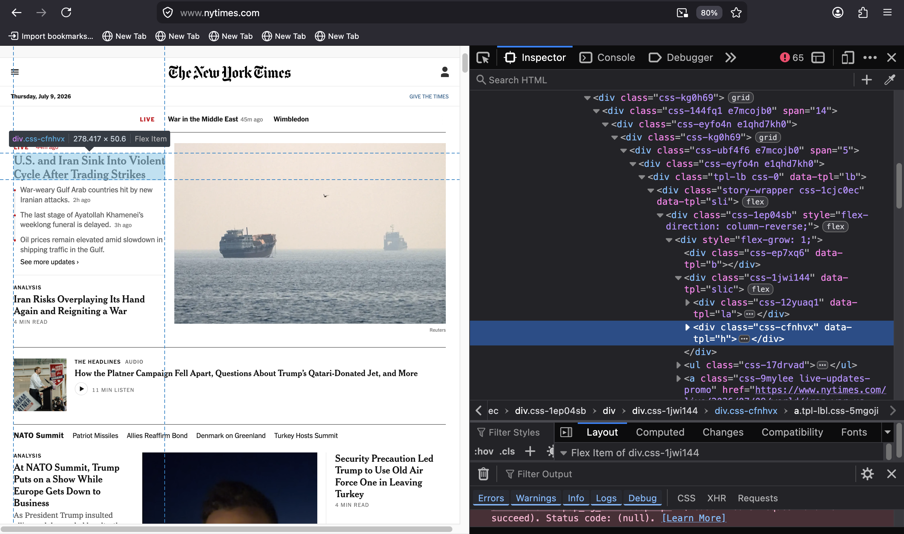

* bank
** Sedgwick
*** critique of Butler
In the influential final pages of Gender Trouble, for example, Butler
offers a programmatic argument in favor of demystification as "the
normative focus for gay and lesbian practice,"'" with such claims as
that "drag implicitly reveals the imitative structure of gender
itself" (137); "we see sex and gender denaturalizedb y means of a
performance" (138);" gender parody revealst hat the original identity
... is an imitation" (138);" gender performance will enact and reveal
the performativity of gender itself" (139); "parodic repetition ...
exposes the phantasmatic effect of abiding identity" (141); "the
parodic repetition of gender exposes ... the illusion of gender
identity" (146); and "hyperbolic exhibitions of 'the natural' ...
reveal its fundamentally phantasmatic status" (147) as well as
"exposing its fundamental unnaturalness" (149; all emphases added).
(/Novel Gazing/ 17).

*** shame as contagion
Shame thus moves outward, creating a nexus for interpersonal relation.
Sedgwick links shame to contagion:
#+begin_quote
“Shame—-living, as it does, on and in the muscles and capillaries of
the face—-seems to be uniquely contagious from one person to another.
And the contagiousness of shame is only facilitated by its anamorphic,
protean susceptibility to new expressive grammars" (/Touching Feeling/
63).
#+end_quote
In the orbit of queerness, where negative experiences are identity
forming, Sedgwick looks at shame as a positive force.

#+begin_quote
“Shame... is not a discrete intrapsychic structure, but a kind of free
radical that (in different people and different cultures) attaches to
and permanently intensifies or alters the meaning of—-of almost
anything: a zone of the body, a sensory system, a prohibited or indeed
a permitted behavior, another affect such as anger or arousal, a named
identity, a script for interpreting other people’s behavior toward
oneself" (/Touching Feeling/ 62)
#+end_quote

*** knowledge: not to know how far a thing is generalizable
Yet, even in this early work, Sedgwick pursues a critical method that
is local. In /Epistemology/, she writes that: “A point of the book is
not to know how far its insights and projects are generalizable... The
book aims to resist in every way it can the deadening pretended
knowingness by which the chisel of modern homo/heterosexual
definitional crisis tends, in public discourse, to be hammered most
fatally home” (12). Here she gives away a certain critical openness
that will then lead her to her thinking in /Novel Gazing/ and
/Touching/Feeling/. She isn’t aiming for generalizable or abstract
critical theories---she knows that any totalizing theory would be more
hurtful than helpful. She’s carving out a space for what she
eventually comes to say about the need to open up possibilities for
connection with texts.
*** on PODG
How do these sexual categories and closet which they structure appear
in 19th-20th century literature? For example, her chapter on Oscar
Wilde's /The Picture of Dorian Gray/ examines abstraction and
figuration as strategies for encoding male on male desire which
otherwise couldn't be expressed: "the modernist impulse toward
abstraction in the first place owes an incalculable part of its energy
precisely to the turn-of-the-century male homo/hetero definitional
panic... the 'figuration' that had to be abjected from modernist
self-reflexive abstraction was not the figuration of figurality
itself, but, rather, that represented in a very particular body, the
desired male body" (/Epistemology/, 167).
*** "for someone to have an unmystified, angry view of large and
genuinely systemic oppressions does not /instrinsically/ or
/necessarily/ enjoin on that person any specific train of
epistemological or narrative consequences" (/Novel Gazing/ 4).
  
*** strong theory, however, can hide the reparative
- strong theory, however, can contain elements of reparative.
  - "But who reads The Novel and the Police to find out whether its
    main argument is true? In this case, as also frequently in the
    case of the tautologies of "sexual difference," the very breadth
    of reach that makes the theory strong also offers the space---of
    which this book takes every advantage---for a wealth of tonal
    nuance, attitude, worldly observation, performative paradox,
    aggression, tenderness, wit, inventive reading, obiter dicta, and
    writerly panache" (/Novel Gazing/ 14).
*** on hope
Hope is a means for putting even traumatic things together
reparatively.

"Because there can be terrible surprises, however, there can also be
good ones. Hope, often a fracturing, even a traumatic thing to
experience, is among the energies by which the reparatively positioned
reader tries to organize the fragments and part-objects she encounters
or creates. Because she has room to realize that the future may be
different from the present, it is also possible for her to entertain
such profoundly painful, profoundly relieving, ethically crucial
possibilities as that the past, in tum, could have happened
differently from the way it actually did." (/Novel Gazing 23-24)
** web scraping
*** the parts of a URL
The URL is a miniature API. It contains all of the information needed
to interface with the data stored on a website. The parts of the URL contain a map for finding information on a
specific website.

Take the ~congress.gov~ website, for example. If someone were to run a
search for the keyword, "gender," the URL would look like the
following:

#+begin_src
  https://www.congress.gov/search?q=%7B%22congress%22%3A%5B%22119%22%5D%2C%22source%22%3A%22all%22%2C%22search%22%3A%22gender%22%7D
#+end_src

This URL encodes information about results on the page. qThe first
part of the URL, from the https:// to the domain ~.gov~ is the root:
~https://www.congress.gov~. The part following is the path, ~/search~.
It indicates a particular section of the website. The final part,
everything following the question mark, ~?~ is the query. The query
itself contains embedded instructions. In this case, the query
performs a ~search~ on all types of documents ~all~ for the keyword
~gender~.

*** bytes
Websites are stored in web servers, accessed over a network. Web data
travels over the network in the form of bytes, the smallest portable
data unit. When the web data reach the web browser, it are decoded
into HTML language, which is assembled into a web page readable by
human eyes.
*** bs4 request
Below is an example of the code used to scrape the home page of /The
Heritage Foundation/ website. The code uses the ~bs4~ and ~requests~
libraries in python. The ~requests~ library is one of the most popular
libraries in the python programing language. Enabling programs to send
and receive data through HTTP networks (i.e., the internet), it is the
bedrock for virtually all web scraping and API tasks.

#+begin_src python
  from bs4 import BeautifulSoup
  import requests
  r = requests.get('https://www.heritage.org/gender')
  source = r.content
  soup = BeautifulSoup(source, 'html.parser')
#+end_src
The ~get()~ function (on line 3) uses the HTTP method ~GET~ to request
data from a server. 
*** scraping Heritage with bs4
homepage, which is saved in the form of bytes via the
~content~ property. Then, using ~bs4~, a python library for working
with HTML data, the data is parsed into an object called ~soup~
(following ~bs4~'s naming conventions), which is a pythonic object of
HTML data.

The beauty of ~bs4~ is that it makes HTML---a notoriously fussy
language that is the reason why so many web frameworks exist in the
first place, attempting to abstract the user from working directly in
HTML---accessible through simple python syntax.

For example, the expression ~soup.title~ returns the following output: 

#+begin_src python
  >>> soup.title
  <title data-rh="true">The New York Times - Breaking News, US News, World News and Videos</title>
#+end_src

Similarly, other HTML elements can now be accessed using python
dot syntax.

#+begin_src python console
  >>> soup.p
  
Make sense of the day’s news and ideas.

  >>> soup.a
  <a class="css-kgn7zc" href="#site-content">Skip to content</a>

  >>> soup.h1
  <h1 class="css-1dv1kvn">New York Times - Top Stories</h1>
#+end_src

Further properties like ~text~ (for just text) and functions like
~find()~ are also possible. Functions can be further specified when
combined with the ~class_~ parameter, to search the HTML with more
precision. Due to python syntax, they can also be chained together to
create complex expressions. These building blocks enable programmers
to navifate the HTML tree with granularity.

#+begin_src python console
  >>> soup.h1.text
  'New York Times - Top Stories'
  
  >>> soup.find('div', class_ = 'css-cfnhvx')
  
<a class="tpl-lbl css-5mgoji" data-tpl="l" href="https://www.nytimes.com/live/2026/07/09/world/iran-war-us-trump">

U.S. and Iran Sink Into Violent Cycle After Trading Strikes

</a>

  >>> soup.find('div', class_ = 'css-cfnhvx').text
  'U.S. and Iran Sink Into Violent Cycle After Trading Strikes'
#+end_src

HTML classes for an element can be found by using built-in browser
tools like the web inspector. On the webpage, right click on the
relevant text and select ~inspect~ from the dropdown menu. The element
will be highlighted with information for the ~class~ attribute.[fn:2]

Using ~requests~, ~bs4~, and the web inspector, one can easily grab a
list of the current headlines from the /NYTimes/ homepage.

#+begin_src python 
>>> for i in soup.find_all('div', class_ = 'css-cfnhvx'):
        print(i.text)
"U.S. and Iran Sink Into Violent Cycle After Trading Strikes
Iran Risks Overplaying Its Hand Again and Reigniting a War
At NATO Summit, Trump Puts on a Show While Europe Gets Down to Business
Security Precaution Led Trump to Use Old Air Force One in Leaving Turkey
‘A Slow-Rolling Disaster’: Inside the Implosion of the Platner Campaign
What’s Next for Democrats in the Senate Race in Maine
How Democrats and Republicans Diverge on Sexual Assault Allegations
Platner Suspends Senate Bid in Maine After Rape Accusation
Trump’s Loyal Defender at the Vatican
Trump Says He’ll Ask Supreme Court to Rehear Citizenship Case, an Unlikely Event
Can Trump’s Arch Be So Tall? A Law May Be Redefined to Get to Yes.
Morocco Faces France and Its Star, Mbappé, in Quarterfinals
A Colonial Past Mixes With the Global Present
How Morocco’s Diaspora Became the Team’s Driving Force
13 Red Cards Have Been Given at the World Cup. Not All Have Been Equal."
#+end_src

Anything else to say about HTTP?
** abigail shrier, irreversable damage
A book by Abigail Shrier, called "Irreversible Damage: The Transgender
Craze Seducing Our Daughters" argues is that minors, who do not know
what they want, cannot be trusted to make what she calls
"irreversable" decisions.

Her tone throught the book is ironic and, like so much of transphobia,
has troubling subtexts. According to Shrier, even something like
social transition, in which a person changes names, pronouns, and
dress, is dangerous and should be avoided.

She says things like: "if the government can’t force students to
salute a flag, the government can’t force a healthcare worker to utter
a particular pronoun. In America, the government can’t make people say
things--not even for the sake of politeness. Not for any reason at
all" (xx).

Through the comparision to patriotism, and a particular enforced
patriotism of a compulsory flag salute, the subtext here seems to be
that compelling pronoun usage would be fascist. Which is, I think, a
strange way to make a point to what is likely a conservative
readership. Unless the point is precisely that some kinds of
expression should be free while others should not.
** ACLU
There is, as
expected, a strong contrast between how genders are conceptualized
between the model trained on the ACLU data and model trained on the
Heritage data. The ACLU model responds with the following definitions:
#+begin_quote
  Masculinity is a matter of love and celebration.

  Masculinity is a space for hope and liberation for all.

  Masculinity is not defined solely by the beauty of our bodies, but by
  the beauty of our experiences.

  Femininity is a celebration of beauty, feminine liberation, and
  femininity.

  Femininity is our joy, our struggle, and our fight is our struggle.

  Femininity is about allowing people to express themselves without
  government interference. (Appendix 1)
#+end_quote
The outputs from this model, trained on progressive source data, align
with what one might expect from a perspective that affirms gender
diversity and expression. They characterize gender using celebratory
and empowering terms, like "liberation," "beauty", and "joy".

Interestingly, a similar phenomenon occurs in the ACLU model. This time, the overlap occurs in the concept of "reality":
#+begin_quote
Masculinity is real and meaningful.

Transgenderism is a false ideology that is not real and that is
opposed by the very people who seek to deny that freedom and equality
for all.

The gender binary is not real, it is real, and it is real.

The gender binary is not a binary, it is a reality within us.

The gender binary is not an accepted reality, but one that is accepted
by a wide swath of people.
#+end_quote
While the conservative side expresses derision in its references to "subjectivity", the liberal side expresses ambivalence around the concept of "reality." Here, reality is asserted in both positive ways, such as "Masculinity is real," and in negative ways, such as "Transgenderism is a false ideology that is not real." 

This ambivalence reflects a concern, on the progressive side, over the
supposed "reality" of gender identification as an external and
objective phenomenon. While the conservative model appears invested in
how personal thoughts and feelings affect gender identification, the
progressive model appears invested in the external and universal
recognition of gender identity.

This middle ground opens sites where both sides might come to mutual
understanding. In this case, the concerns with subjectivity and
reality suggests that the polarized positions share investments in
gender as an external phenomenon. In other words, both sides appear to
agree that gender needs to be grounded in some way.

This insight, in fact, accords with what some Trans Studies scholars
argue about the conceptualization of gender, and how defining gender
as internal causes more harm than good, creating the potential for
transphobic discrimination. According to Kadji Amin, the
internalization of gender identity creates a domino effect where
gender is increasingly divorced from bodily expression. In this
situation, normative genders become both default and
invisible—unmarked as such. As a result, any visibly non-normative
genders have a higher likelihood of experiencing discrimination and
stigmatization for their visible difference. Such stigmas are borne
out in public life where, for example, masculine gay men are more
likely to participate and achieve prominence over gay men who are
visibly non-normative or gender-bending.

In the polarized gender discourse, the liberal investment in "reality"
and the conservative investment in "subjectivity" concentrate internal
tensions within their respective sides, which text capture, combined
with close reading, can bring to the surface. Rather than aim for
objectivity, then, this methodology locates sites of overlap within
tension and conflict. 

** circular relationship between investment and acquisition
Like with the Zyte report, there is a cycle here in which increasing
data and AI technology feed each other. This cycle manifests in real
circular relationships between companies, where AI companies who have
the technology must work with cloud companies who have the necessary
servers and GPUs to handle higher compute. The vast majority of the
capital raised by these AI companies are paid to the cloud providers,
who in turn are responsible for majority of the investment into the AI
companies. As the authors point out, “These circular investment deals
can blur the boundary between 'investment' and 'acquisition'".
(Varoquaux et al 8).
** maniacal obsession with more:
Situational Awareness hedge fund founded by Leopold Aschenbrenner,
named after the 165-page "Situational Awareness: The Decade Ahead"
essay by Aschenbrenner,[fn:12] which announces that "The most
extraordinary techno-capital acceleration has been set in motion." The
document begins evoking San Francisco as the herald of the world to
come:

#+begin_quote
You can see the future first in San Francisco. 

Over the past year, the talk of the town has shifted from $10 billion
compute clusters to $100 billion clusters to trillion-dollar clusters.
Every six months another zero is added to the boardroom plans. Behind
the scenes, there’s a fierce scramble to secure every power contract
still available for the rest of the decade, every voltage transformer
that can possibly be procured. American big business is gearing up to
pour trillions of dollars into a long-unseen mobilization of American
industrial might. By the end of the decade, American electricity
production will have grown tens of percent; from the shale fields of
Pennsylvania to the solar farms of Nevada, hundreds of millions of
GPUs will hum.

The AGI race has begun. (Aschenbrenner, "Situational Awareness")
#+end_quote

For anybody that has been to San Francisco, the future is bleak. 

** centralizing power
LLMs also centralize power, where only the handful of richest tech
companies can afford to buy the infrastructrure needed to train the
models. As a result, the interests of those companies will drive
further research in development, which will inevitably be focused on
size. Varoquaux et al point out that the emphasis on scale
"exacerbates a concentration of power, which centralizes
decision-making in the hands of a few actors while threatening to
disempower others" ([Varoquaux et al., 2025, p. 1).
** copyright cases
- argue that transformative use protects them copyright, makes their
  use "fair"

One famous lawsuit against the AI company Anthropic, the /Bartz v.
Anthropic/ lawsuit, settled with a historic 1.5 billion payout to
content creators. Despite this payout, the court asserts that the
capture content for training AI models falls under "fair use"
copyright protection with District Court Judge William Alsup claiming
that,
#+begin_quote
the purpose and character of using copyrighted works to train LLMs to
generate new text was quintessentially transformative. Like any reader
aspiring to be a writer, Anthropic’s LLMs trained upon works not to
race ahead and replicate or supplant them — but to turn a hard corner
and create something different.[fn:24] (13-14)
#+end_quote
In this case, the judge asserts that the output of capture was
"quintessentially transformative," thus fulfilling one of they key
principle of fair, that a derivative work is fundamentally different
from the work it is based on (a point which I will address in the last
chapter). However, the judge left open the role of another key
princple of fair use, which is whether the act of taking content via
web scraping is protected under fair use. Here, Judge Alsup states
that "Pirating copies to build a research library without paying for
it, and to retain copies should they prove useful for one thing or
another, was its own use — and not a transformative one" (19).

When human-generated content is treated as feed for training data,
then human labor itself is degraded.
** abundance
Language of the tech CEOs themselves, which draw on the language of
abundance, in the written statements and spoken interviews. Even
statements that seem to have differing messages, such as Sam Altman's
"Abundant Intelligences," Mark Zuckerber's "The Future Is For
Everyone," which encourage growth at top speed, and Dario Amodei's "We
Must Pace the Frontier," which encourage moderation in growth,
ultimately make the same promise: a world which is abundant for
everyone.

Altman, Sam. "Abundant Intelligence." September 23, 2025.
https://blog.samaltman.com/abundant-intelligence. Zuckerberg, Mark.
"The Future is for Everyone: The Path to a Positive AI Future." August
10, 2026. https://www.meta.com/thefutureisforeveryone/; Dario Amodei,
We Must Pace the Frontier, September 2026:
https://darioamodei.com/post/we-must-pace-the-frontier

** OpenAI on democracy, freedom, learning, fair use
On March 13, 2025, the company OpenAI responded to the call
for AI policy recommendations from the White House Office of Science
and Technology Policy (OSTP).

The forces of capture converge toward centralization and total
control. They are against dispersion. They prefer hegemonic
structures, for example of signification, where there can be only one
meaning. The hegemony of meaning by necessity conscripts the security
enterprise into the commercial one.

In a totalizing view, freedom becomes control, not a new narrative. 

In 2006, Wendy Chun writes about this effect at the start of the fiber
optic age, that "“a technology, which thrives on control, has been
accepted, however briefly as a mass medium of freedom” (/Control and
Freedom/ vii). Chun traces this history back to the 1996
Telecommunications Act, signed into law by President Bill Clinton,
which deregulated the telecommunications market, opening it up to
private companies. While this move enabled the expansion of network
access, it also quickly concentrated the industry into the hands of a
few powerful companies. One effect, key for Chun's argument, is the
conflation of "freedom" and "control." Although fiber optic technology
promises freedom of communication, it relies on strict protocols that
determine how one node connects to another. To Chun, the issue isn’t
the control inherent to network protocols that drive the internet, but
in the way that the protocols are obscured by a narrative of freedom,
which includes values of privacy: “If you believe that your
communications are private, it is because software corporations, as
they relentlessly code and circulate you, tell you that you are
behind, and not in front of, the window” (22).

Similar conflations of "freedom" and "control" occur in the present
day in language around AI production. In a proposal of recommendations
for developing technology policy, OpenAI, for example, poses American
values of "freedom" and "democracy" against the "autocratic,
authoritarian" People's Republic of China (PRC).[fn:19] OpenAI asserts
a series of "freedoms" endows to Americans, including "the freedom to
access and benefit from AGI"---that is, for consumer access to
commercial products like ChatGPT; the "freedom to innovate," whereby
American companies would be exempt from complying with "overly
burdensome state laws" around AI use, such as those requiring safety
and bias checks ("AI Laws and Regulation in the United States
(2026)"); and finally, there is a "freedom to learn," which, rather
slyly, refers the freedom of machines (rather than human beings) to
learn (Lehane 2). The freedom to learn, as the proposal itself admits,
is really the "ability to learn from copyrighted material" without
having to pay for the content (Lehane 5).

The remarkable hypocrasy around data theft comes into the starkest
illustration when discussing the "fair use" exemption from copyright
law.
#+begin_quote
The rapid advances seen with the PRC’s DeepSeek, among other recent
developments, show that America’s lead on frontier AI is far from
guaranteed. Given concerted state support for critical industries and
infrastructure projects, there’s little doubt that the PRC’s AI
developers will enjoy unfettered access to data—--including
copyrighted data—--that will improve their models. If the PRC’s
developers have unfettered access to data and American companies are
left without fair use access, the race for AI is effectively over.
America loses, as does the success of democratic AI. (Lehane 9-10)
#+end_quote
While the US's access to the same data is "fair," China's access to
the same data is "unfettered"---despite there being no difference in
the datasets (something like the entire web) and the methods of web
scraping and web crawling, which are used to obtain them.

"Freedom" is strange in this context --- it's a US value, being
contrasted to China's "autocratic" values. Yet, freedom is deployed in
the service of making the US policy effectively more like that of
China's. The autocratic qualities of the PRC, which allows it to
develop its AI free of regulation and copyright considerations, is
exactly what the US is asking for in this proposal.
